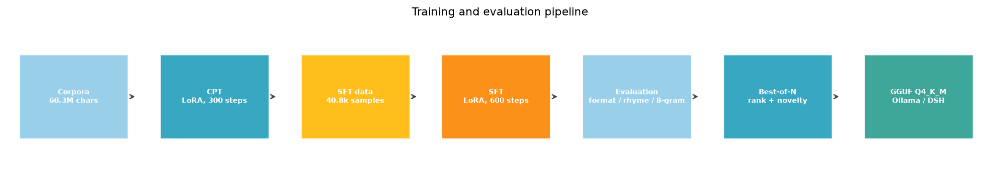
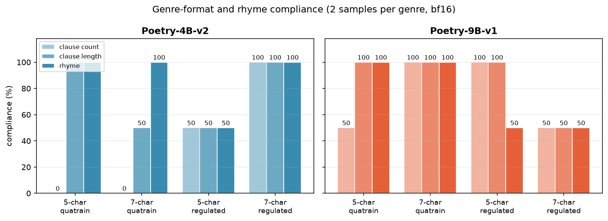

# classical-poetry-lm · 古典诗文写作模型（Qwen3.5）

用 **Qwen3.5-4B / 9B** 在 **Windows 原生环境（RTX 5090 Laptop 24GB）** 上训练一个会写 **近体诗、词、明清古文、骚体赋** 的中文模型。

训练路线：**领域 CPT（继续预训练）→ 指令 SFT（含真实诗拟作、真实诗话评点、散文仿写、扩写）→ 自动评估（体裁/押韵/抄袭）→ 量化部署（Ollama）**。

> 精选作品集： [`reports/qwen3.5-9B-诗文专家模型选.pdf`](reports/qwen3.5-9B-诗文专家模型选.pdf)（18 页，含编者评点）

## HuggingFace

- 模型（4B v2）: https://huggingface.co/Shokou1/qwen3.5-poetry-4b-v2
- 模型（9B v1）: https://huggingface.co/Shokou1/qwen3.5-poetry-9b-v1
- 数据集: https://huggingface.co/datasets/Shokou1/classical-poetry-sft

> 模型权重在 HF 上以 40MB 分片存放（网络原因），仓库内附 `merge_chunks.py` 一键合并。





## 模型

| 模型 | 基座 | 训练 | 量化 | 状态 |
|---|---|---|---|---|
| `poetry-4b-v2` | Qwen3.5-4B | CPT 300 步 + SFT 600 步（含扩写数据） | Q4_K_M 2.58GB | ✅ Ollama 可用 |
| `poetry-9b-v1` | Qwen3.5-9B | SFT 600 步（seq768, LoRA r32） | Q4_K_M ~5.2GB | ✅ LoRA 已训完，GGUF 导出中 |

- 两个模型均采用 **bf16 LoRA**（r=64/32，all-linear）；Windows 上 bitsandbytes 4bit 极慢（~42 tok/s），故不用 QLoRA。
- 训练显存：4B seq1024 定长 ≈ 15GB；9B seq768 定长 ≈ 22GB。

## 数据

| 语料 | 规模 | 用途 |
|---|---|---|
| 全唐诗 / 全宋诗 | 56,589 / 252,852 首 | 拟作 SFT、韵律统计 |
| 宋词 / 元曲 | 21,053 / 11,057 | 词曲能力 |
| 诗话 / 词话 / 文评 | 1,133 / 358 / 426 万字 | 评点、鉴赏 |
| 明文海 / 明文衡 / 古文观止 / 清文精选 | 4,168 篇 / 354 万字 | 明清散文 |
| 四库别集 | 1,279 部 / 471.6MB | CPT 扩充 |
| **CPT 语料** | **382,191 条 / 6,033 万字** | 领域继续预训练 |
| **SFT v3** | **40,813 条**（拟作 15k + 真实诗话 13k + teacher 评点 9k + 扩写 1.5k） | 指令微调 |

数据来源：`chinese-poetry`、`daizhigev20`、`Classical-Modern` 等公开语料（各自遵循原许可）。本仓库只放**样例数据**；完整数据与 LoRA adapter 计划发布到 ModelScope / HuggingFace。

## 方法要点

1. **CPT**：4B，seq2048 packing，LoRA r64，1e-4，300 步 ≈ 980 万 tokens，loss 3.6 → 2.36。
2. **SFT 数据构建**：
   - 由 30 万真实诗构造「风格标签 + 题目 + 体裁要求 → 原诗」拟作样本，**按作者切分**验证集防背诵；
   - 真实诗话「引诗 + 评语」对 13k 条；
   - DeepSeek-V4.1-Flash teacher 生成评点/鉴赏/仿写/扩写（1 万条 ≈ ¥111，扩写 400 条 ≈ ¥2.4）。
3. **Windows 训练稳定性**：SFT 必须**定长 padding**；变长 batch 会导致 CUDA 分配器碎片化（reserved 27GB → OOM）。训练前需 `ollama stop`。
4. **押韵评估**：从 139,408 首近体诗统计，拼音韵母完全一致仅 15.6%；按**数据驱动韵部簇**（36 韵母 → 9 簇，真实诗一致性 **86.5%**）判断更合理。
5. **抄袭检测**：31.3 万篇语料 → **1,709 万 8-gram 指纹**（CRC32 + numpy），归一简繁；名篇原文可被识别（杜牧《秋夕》overlap 0.619）。
6. **Best-of-N 生成**：按句数、句长、韵部、抄袭率打分选优；overlap>0.2 直接否决。

## 结果

### 体裁合规（2 采样/体裁，bf16）

| 体裁 | 4B v2 句数/句长/押韵 | 9B v1 句数/句长/押韵 |
|---|---|---|
| 五绝 | 0/2 · 2/2 · 2/2 | 1/2 · 2/2 · 2/2 |
| 七绝 | 0/2 · 1/2 · 2/2 | **2/2 · 2/2 · 2/2** |
| 五律 | 1/2 · 1/2 · 1/2 | **2/2 · 2/2** · 1/2 |
| 七律 | **2/2 · 2/2** · 2/2 | 1/2 · 1/2 · 1/2 |

八类任务与语料 8-gram 重复均 ≤0.01（无背诵）。Q4 量化后押韵略有下降（4B: 0–1/2）。

### 样例（9B，Best-of-N）

> 九嵏峰頂倚危欄，萬里江天盡目寒。
> 歸鴈不隨秦帝駕，殘蟬猶訴漢宮歡。
> 山川不改英雄恨，日月無情壯士肝。
> 回首故人多老矣，不堪煙雨寄征鞍。

更多见 [reports/best-pieces.md](reports/best-pieces.md)。

## 快速开始

```powershell
# Ollama 导入（已有 GGUF 时）
ollama create poetry-4b-v2 -f .\scripts\Modelfile.poetry-4b-v2
ollama run poetry-4b-v2 "【唐·王维·五绝·山水】请作五言绝句一首，写山中月夜。"
```

复现训练：见 [reports/reproduction-guide.md](reports/reproduction-guide.md)。

## 局限

- **格律放宽**：只校验句数/句长/押韵，不校验平仄（平水韵完整韵书未用）。
- **Q4 量化损失**：押韵与句数稳定性下降，敏感场景建议用 bf16 adapter 或 Best-of-N。
- **背诵风险**：训练数据含真实名篇，低步数时会复现名篇（已加入指纹检测与 Best-of-N 否决；9B 600 步后本集所选均 <0.01）。
- **9B 显存**：24GB 卡只能 seq768；seq1024 会贴顶。

## 许可

- 代码：MIT
- 模型：基座 Qwen3.5（Apache-2.0），LoRA adapter 将在 ModelScope/HF 发布
- 语料：遵循各原始数据集许可（chinese-poetry、daizhigev20 等）

## 引用

```bibtex
@misc{classicalpoetrylm2026,
  title  = {classical-poetry-lm: Training Qwen3.5 for Classical Chinese Poetry and Prose},
  author = {ShokouP},
  year   = {2026},
  url    = {https://github.com/ShokouP/classical-poetry-lm}
}
```
