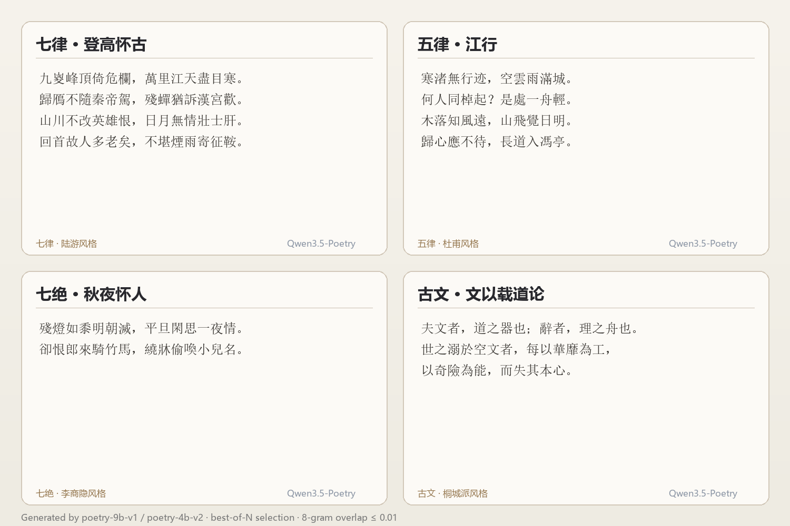
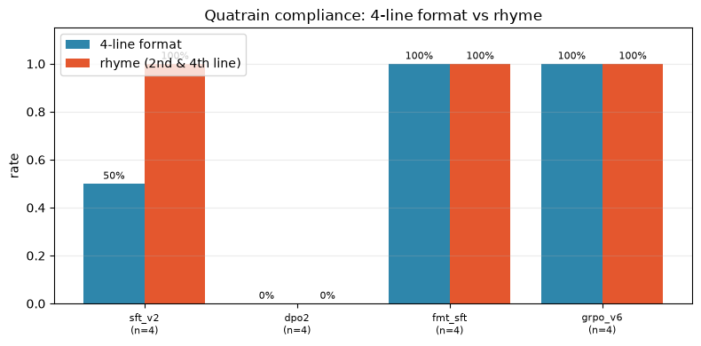
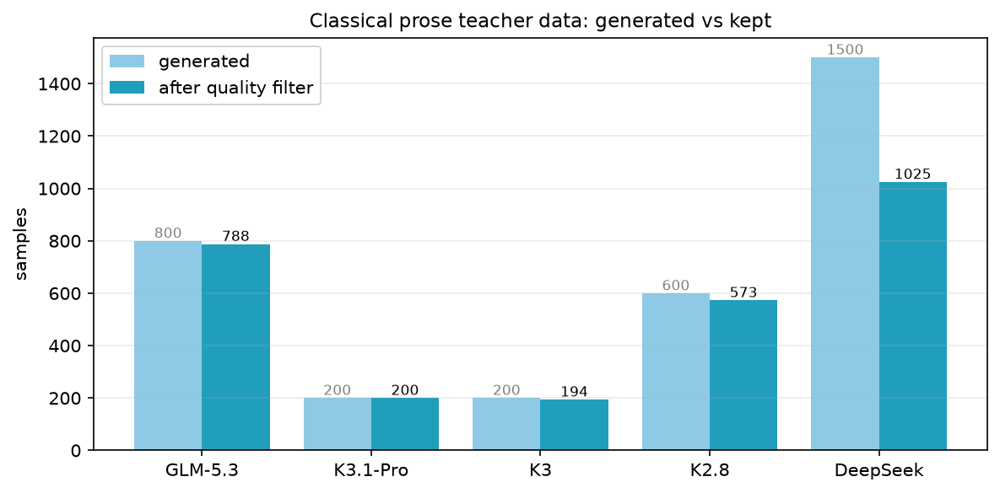
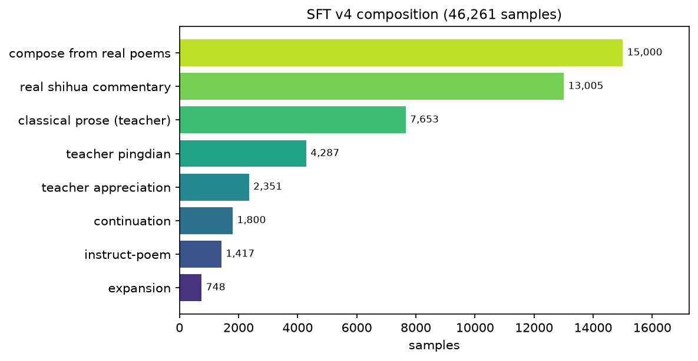
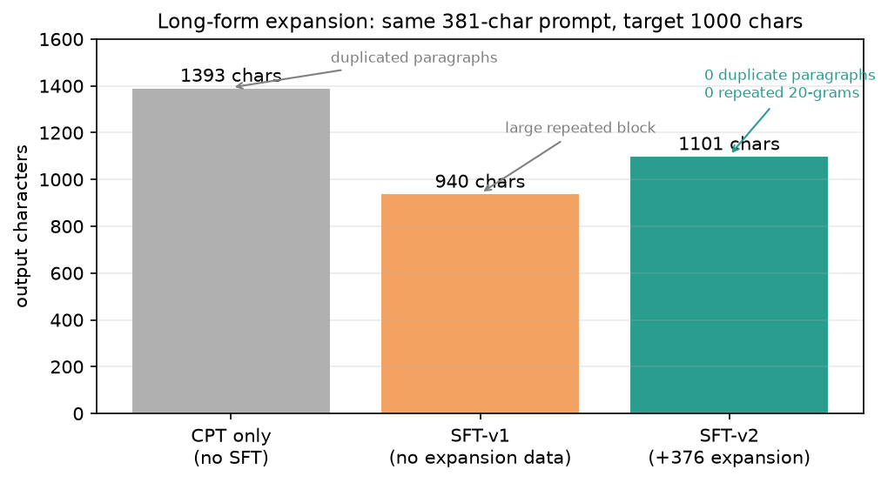

# 🏮 一张消费级显卡，炼出一个会写唐诗宋词的 AI

> **TL;DR**：用 **RTX 5090 Laptop（24GB）** 在 **Windows 原生环境**上，把 Qwen3.5 训成会写**近体诗、词、明清古文、骚体赋**的模型。
> 全程开源：**30 万首真诗**训练数据 → CPT → SFT → **5 家最强模型当老师**生成古典散文 → 偏好对齐 → 量化部署，**总花费不到 ¥150 API 费**。

[](https://github.com/ShokouP/classical-poetry-lm)
[](https://huggingface.co/Shokou1)
[]()
[]()

**它写出来的东西**（七律 · 登高怀古）：

> 九嵏峰頂倚危欄，萬里江天盡目寒。
> 歸鴈不隨秦帝駕，殘蟬猶訴漢宮歡。
> 山川不改英雄恨，日月無情壯士肝。
> 回首故人多老矣，不堪煙雨寄征鞍。



## 📚 目录

- [为什么值得看](#-为什么值得看)
- [三分钟上手](#-三分钟上手)
- [模型 & 数据](#-模型--数据)
- [怎么训的](#-怎么训的)
- [多 Teacher 古典散文](#-多-teacher-古典散文)
- [评测结果](#-评测结果)
- [踩过的坑](#-踩过的坑)
- [精选作品集](#-精选作品集)
- [HuggingFace / GitHub](#-huggingface--github)

## 🎯 为什么值得看

| 亮点 | 说明 |
|---|---|
| **真诗驱动** | 30.9 万首唐诗宋词直接构造指令数据，**按作者切分**防背诵 |
| **5 家老师当外挂** | GLM-5.3 / K3.1-Pro / K3 / K2.8 / DeepSeek-V4.1 生成古典散文，**2,780 条过滤后入训** |
| **自动评测三件套** | 体裁合规 + **9 韵部簇**（86.5% 一致性）+ **1,709 万 8-gram 抄袭指纹** |
| **Windows 可用** | 避开 QLoRA（4bit 慢 36 倍），bf16 LoRA + 定长 padding，**9B seq768 稳跑 22GB** |
| **全部开源** | 数据构造 / 训练 / 评测 / GGUF 导出 / Ollama 部署脚本一条龙 |

> 精选作品集： [`reports/qwen3.5-9B-诗文专家模型选.pdf`](reports/qwen3.5-9B-诗文专家模型选.pdf)（18 页，含编者评点）

## ⚡ 三分钟上手

```bash
# Ollama（推荐）
ollama pull poetry-9b-v1   # 5.2GB Q4_K_M，写完即可用
ollama run poetry-9b-v1 "【唐·王维·五绝·山水】请作五言绝句一首，写山中月夜。"
```

```python
# Transformers + LoRA
from peft import PeftModel
from transformers import AutoTokenizer, Qwen3_5ForCausalLM

tok = AutoTokenizer.from_pretrained("Qwen/Qwen3.5-9B", trust_remote_code=True)
model = Qwen3_5ForCausalLM.from_pretrained("Qwen/Qwen3.5-9B", dtype="bfloat16", device_map="auto")
model = PeftModel.from_pretrained(model, "Shokou1/qwen3.5-poetry-9b-v1")
```

## 📊 模型 & 数据

| 模型 | 基座 | 训练 | 量化 | Ollama |
|---|---|---|---|---|
| `poetry-4b-v2` | Qwen3.5-4B | CPT 300 + SFT 600（含扩写） | Q4_K_M 2.58GB | ✅ |
| `poetry-9b-v1` | Qwen3.5-9B | SFT 600（seq768, r32） | Q4_K_M 5.24GB | ✅ |
| **`poetry-9b-v7`** | Qwen3.5-9B | **SFT 格式修复 → 押韵 SFT（真实绝句 6000）→ GRPO v7（8 prompt × G8）** | Q4_K_M 5.6GB | **✅ 最新** |

### format & rhyme compliance（4 个绝句 prompt）

| 模型 | 4 句格式 | 押韵（第 2/4 句同韵部） | 8-gram 抄袭 |
|---|---:|---:|---:|
| sft_v2 | 2/4 | — | — |
| dpo2 | 0/4 ❌ | — | — |
| fmt_sft | **4/4** | 4/4 | 1 条抄《鹿柴》❌ |
| **grpo_v7** | **4/4** | **4/4** | **0.00 ✅** |



**poetry-9b-v7 实测输出**（Ollama）：

```
月出山欲空，清光落寒松。
幽人独对此，不觉夜来钟。
```

> 五绝 · 4 句 × 5 字 · 「空/松/钟」同韵 · 8-gram 重叠 0.00

| 数据 | 规模 |
|---|---:|
| 全唐诗 / 全宋诗 | 56,589 / 252,852 首 |
| 宋词 / 元曲 | 21,053 / 11,057 |
| 诗话 / 词话 / 文评 | 1,133 / 358 / 426 万字 |
| 明清散文（明文海等） | 4,168 篇 / 354 万字 |
| 四库别集 | 1,279 部 / 471.6MB |
| **CPT 语料** | **382,191 条 / 6,033 万字** |
| **SFT v4** | **46,261 条** |
| **古典散文（多 teacher）** | **2,780 条** |
| **DPO 偏好对** | **987 对**（正例来自 5 家强模型） |

## 🔬 怎么训的

```
公开语料 6,033 万字
   ↓ CPT（LoRA r64, seq2048 packing, 300 步）
Qwen3.5-4B 适应古典文风（loss 3.57 → 2.36）
   ↓ 构造 40,813 条指令数据（真诗拟作 15k + 真诗话 13k + teacher 评点 9k + 扩写）
   ↓ SFT（LoRA, 定长 padding, 600 步）
   ↓ 追加 5 家 teacher 古典散文 7,653 条（加权）
SFT v4（46,261 条）
   ↓ DPO（5 家强模型正例 + 自模型负例，缓存参考 logps）
偏好对齐模型
   ↓ 合并 → GGUF Q4_K_M
Ollama / DSH / llama.cpp
```


## 🏛 多 Teacher 古典散文

五家强模型生成古典散文（记/序/论/传/说/赋/铭/书），**作家风格轮转**避免同质化，全部经四重过滤：

1. **抄袭检测**：313k 篇语料 / 1,709 万 8-gram 指纹，重叠 >0.12 剔除
2. **现代词检测**：的/了/是 占比 >3% 剔除
3. **名篇黑名单**：滕王阁序 / 项脊轩志 / 兰亭集序 / 赤壁赋
4. **长度窗口**：150–800 字



| Teacher | 生成 | 保留 | 备注 |
|---|---:|---:|---|
| **GLM-5.3** | 800 | 788 | 质量与速度俱佳 |
| **K3.1-Pro** | 200 | **200（100%）** | 议论最有力 |
| **K3** | 200 | 194 | 稳定 |
| K2.8 Preview | 600 | 573 | ⚠️ 18 条整段抄名篇已剔除 |
| DeepSeek-V4.1-Flash | 1,500 | 1,025 | ⚠️ 452 条抄袭被剔除 |



## 📈 评测结果

### 体裁合规（每体裁 2 采样，bf16）

| 体裁 | 4B v2 句数/句长/押韵 | 9B v1 句数/句长/押韵 |
|---|---|---|
| 五绝 | 0/2 · 2/2 · 2/2 | 1/2 · 2/2 · 2/2 |
| 七绝 | 0/2 · 1/2 · 2/2 | **2/2 · 2/2 · 2/2** |
| 五律 | 1/2 · 1/2 · 1/2 | **2/2 · 2/2** · 1/2 |
| 七律 | **2/2 · 2/2** · 2/2 | 1/2 · 1/2 · 1/2 |


### 长文扩写（381 字 → 1000 字，同一 prompt）

| 模型 | 输出字数 | 重复情况 |
|---|---:|---|
| 仅 CPT | 1,393 | 段落重复 |
| SFT v1 | 940 | 大段复读 |
| **SFT v2（+376 扩写数据）** | **1,101** | **0 重复段落 / 0 重复 20-gram** |



### 抄袭检测有效性

- 杜牧《秋夕》原文 → overlap **0.619**（可识别）
- 精选原创作品 → overlap **≤0.01**

## 🕳 踩过的坑

| 坑 | 结论 |
|---|---|
| **QLoRA 在 Windows 极慢** | bnb 4bit 仅 42 tok/s（bf16 是 1,500 tok/s），**不用 QLoRA** |
| **变长 batch → CUDA 分配器碎片化** | alloc 10GB / reserved 27GB → OOM，**必须定长 padding** |
| **DPO 参考策略搞错** | adapter-disable 拿到的是**基座**不是 SFT → loss 0.07 崩坏，**必须缓存 SFT 参考 logps** |
| **批次生成提速 175 倍** | batch 1→24：0.0036/s → 0.63/s |
| **K2.8 会抄名篇** | 整段照搬《师说》《山居秋暝》，必须指纹过滤 |
| **K3.1-Pro 不能关思考** | 只能 `reasoning_effort=low`，temperature 固定 1.0 |
| **MiniMax-M3.1-Flash 强制 adaptive** | 必须 `max_tokens≥6000`，慢 10 倍 |

## 📖 精选作品集

18 页 PDF，含 9 篇作品 + 编者评点：[`qwen3.5-9B-诗文专家模型选.pdf`](reports/qwen3.5-9B-诗文专家模型选.pdf)

论文草稿：[`paper-draft.pdf`](reports/paper-draft.pdf) — *Training Small Language Models for Classical Chinese Poetry and Prose: A Data-Centric Study with Evaluation Beyond Fluency*

## 🔗 HuggingFace / GitHub

- 🤗 模型（4B v2）: https://huggingface.co/Shokou1/qwen3.5-poetry-4b-v2
- 🤗 模型（9B v1）: https://huggingface.co/Shokou1/qwen3.5-poetry-9b-v1
- 🤗 数据集: https://huggingface.co/datasets/Shokou1/classical-poetry-sft
- 💻 本仓库：脚本 / 报告 / 样例数据 / 论文

> 大文件在 HF 上以 40MB 分片存放，仓库内附 `merge_chunks.py` 一键合并。

## 📄 许可

代码 MIT；模型基座 Qwen3.5（Apache-2.0）；数据遵循各原始语料许可。

## 🙏 引用

```bibtex
@misc{classicalpoetrylm2026,
  title  = {classical-poetry-lm: Training Qwen3.5 for Classical Chinese Poetry and Prose},
  author = {ShokouP},
  year   = {2026},
  url    = {https://github.com/ShokouP/classical-poetry-lm}
}
```

